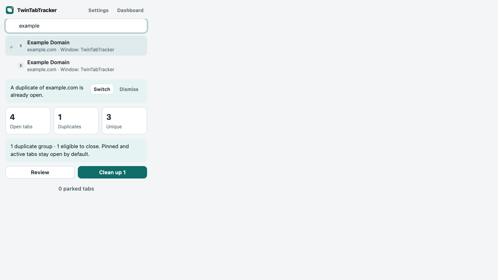

# TwinTabTracker

Find the tabs you need. Eliminate unnecessary duplicates. Keep your browser under control.

TwinTabTracker is a local-first browser extension for tab inventory, duplicate detection, safe cleanup, search, and parked-tab collections. It does not require an account, a server, or access to page content.



## Current status

The Chromium MVP is usable for daily testing. We are dogfooding it this week, tightening the product from real use, and preparing a launch build. Firefox packaging exists but has not been verified in Firefox. Safari is not packaged yet.

**Working today**

- Manifest V3 Chromium extension (Chrome and other Chromium browsers)
- Firefox Manifest V3 package (unverified in Firefox)
- Popup and full-page dashboard
- Exact and smart duplicate matching
- Safe cleanup with preview, protections, and undo
- Tab search and switch-to-existing-tab
- Parked tabs and collections
- Local settings, light/dark theme, and duplicate-awareness banners
- Unit, component, and synthetic performance tests

**Not in this build**

- Safari packaging, signing, or App Store distribution
- Automatic closing of newly opened duplicates
- Native browser tab-group mutation
- Cloud sync, accounts, analytics, or AI features
- Store listing / published release

The original repository contained only a Manifest V2 stub. That stub was migrated to Manifest V3.

## Try it now

1. Install dependencies and build the Chrome package:

   ```bash
   npm install
   npm test
   npm run build:chrome
   ```

2. In Chrome, open `chrome://extensions`.
3. Enable **Developer mode**.
4. Click **Load unpacked** and select the `dist/chrome` folder in this repository.
5. Pin TwinTabTracker to the toolbar, then open a few duplicate tabs (for example two copies of the same article) and click the extension icon.

After you pull new code, run `npm run build:chrome` again, then click **Reload** on `chrome://extensions`.

## Daily testing notes

If you are using the unpacked build for a few days:

- Keep Developer mode on and reload the extension after each rebuild.
- Try messy real sessions: many windows, pinned tabs, and the same URL with tracking parameters.
- Notice anything confusing, unsafe, or slow, especially around cleanup, undo, and search.
- Settings, parked tabs, and cleanup history stay in this browser’s local extension storage. Uninstalling the extension deletes that data.

Please treat this as a pre-launch build. Do not assume store-quality restoration of form data, scroll position, or logged-in page state after undo.

## Supported browsers

| Browser | Package | Verified in this repo |
| --- | --- | --- |
| Google Chrome | `dist/chrome` | Chrome for Testing 156 smoke passed; load unpacked in branded Chrome to dogfood |
| Microsoft Edge / Brave / Opera | `dist/chrome` | Not verified |
| Firefox | `dist/firefox` | Package built, browser not verified |
| Safari | Not packaged | Not started |

## Permissions

- `tabs` — read tab titles/URLs, switch to a tab, close selected duplicates, reopen restored URLs
- `storage` — save settings, parked tabs, collections, and bounded cleanup history locally
- `sessions` — restore recently closed tabs after cleanup when the browser supports it

No host permissions and no content scripts are used. TwinTabTracker does not read page content.

## Development setup

Requirements: Node.js 20+ and npm.

```bash
npm install
python3 scripts/generate_icons.py
npm test
npm run typecheck
npm run lint
npm run build:chrome
```

Optional Firefox package:

```bash
npm run build:firefox
```

### Useful commands

| Command | Purpose |
| --- | --- |
| `npm run dev` | Vite development build for the extension |
| `npm test` | Unit and component tests |
| `npm run test:coverage` | Tests with coverage |
| `npm run test:chrome` | Smoke-load the built package in Chrome for Testing |
| `npm run typecheck` | Strict TypeScript check |
| `npm run lint` | ESLint |
| `npm run build:chrome` | Production Chromium package in `dist/chrome` |
| `npm run build:firefox` | Production Firefox package in `dist/firefox` |
| `npm run inspect:package` | List and validate package contents |

## How to use it

### Find duplicates

Open the popup or the Duplicates dashboard view. TwinTabTracker groups tabs that share the same canonical URL. Exact mode keeps meaningful query parameters and fragments. Smart mode can ignore common tracking parameters such as `utm_*` and `fbclid`.

### Clean up safely

Review the group, confirm which tab is marked **Keep**, then close the selected extras. By default the extension:

- never closes every copy in a group
- protects pinned tabs
- protects the active tab
- refuses to close the last tab in a window

Cleanup revalidates each tab immediately before closing it. If a tab navigated or disappeared, it is skipped.

### Undo

If the browser exposes recently closed sessions, TwinTabTracker restores those sessions. Otherwise it reopens the original URLs. Reopening a URL does not restore form data, scroll position, or other page state.

### Search

Type in the search box to filter by title, hostname, or URL. Choose a result to activate that existing tab and focus its window. Search does not create a new tab.

### Parked tabs

From **All tabs**, select tabs and park them into a collection. Parked entries are stored locally. Restoring them opens the saved URLs.

## URL matching

Exact mode canonicalizes:

- scheme
- hostname case
- default ports (`80` / `443`)
- query parameter order
- unreserved percent-encoding

It does not strip query values, paths, or fragments, and it does not treat every tab on a domain as a duplicate.

Smart mode additionally drops a documented list of tracking parameters and, by default, URL fragments.

## Privacy

All product features run locally. See [docs/PRIVACY.md](docs/PRIVACY.md).

## Known limitations

- Restricted pages (`chrome://`, `about:`, extension pages, and similar) are listed when possible but cannot always be inspected or closed.
- Private / incognito windows are only visible if the user allows the extension in those windows.
- Undo cannot reconstruct a complete browsing session.
- Duplicate awareness cannot intercept every possible tab-creation path.
- Safari is not packaged.

## Launch prep

This week’s focus is real-world use of the unpacked Chrome build, then Firefox verification, store assets, and a release checklist. Track remaining work in [docs/ROADMAP.md](docs/ROADMAP.md).

## Documentation

- [Product spec](docs/PRODUCT_SPEC.md)
- [Architecture](docs/ARCHITECTURE.md)
- [Testing](docs/TESTING.md)
- [Privacy](docs/PRIVACY.md)
- [Roadmap](docs/ROADMAP.md)
- [Agent notes](AGENTS.md)
