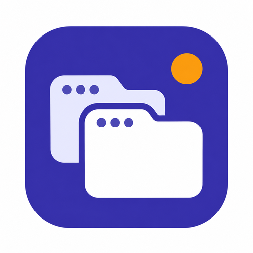
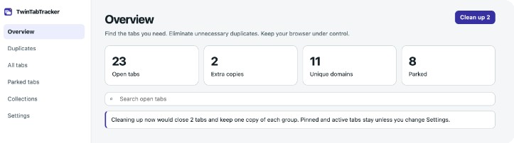
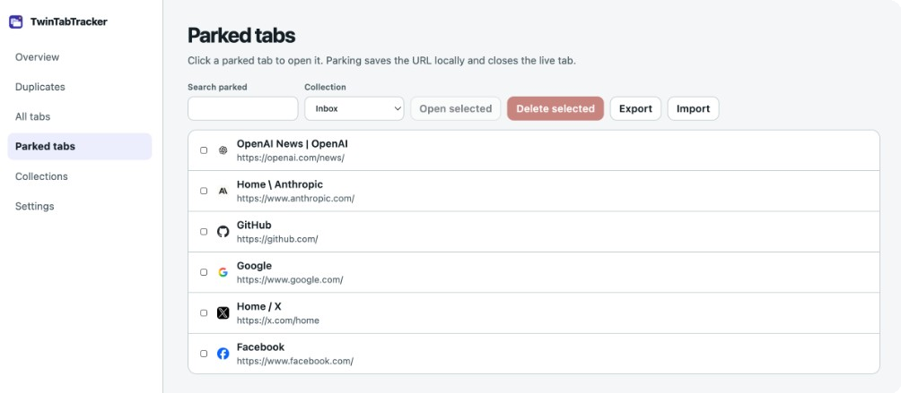

<p align="center">
  
</p>

<h1 align="center">TwinTabTracker</h1>

<p align="center">
  Find the tabs you need. Eliminate unnecessary duplicates. Keep your browser under control.
</p>

TwinTabTracker is a local-first browser extension. It shows your open tabs, groups extra copies of the same URL, and lets you park pages you want later. It does not need an account, a server, or access to page content. Independent project — no company, no analytics.

<p align="center">
  
</p>

<p align="center">
  
</p>

<p align="center">
  
</p>

## What it does

- Finds duplicate tabs by canonical URL (exact or smart matching)
- Cleans up extras without closing the tab you want to keep
- Parks a tab in one click — saves the URL locally and closes the live tab
- Opens a parked tab again with one click
- Searches open tabs and switches to the existing one
- Keeps settings, parked tabs, and cleanup history on this browser

## Install

A store listing is not published yet. Until then, load the package locally.

**Chrome**

1. `npm install`
2. `npm run build:chrome`
3. Open `chrome://extensions`
4. Enable **Developer mode**
5. Click **Load unpacked** and choose the `dist/chrome` folder
6. Pin TwinTabTracker to the toolbar

**Firefox**

1. `npm run build:firefox`
2. Open `about:debugging#/runtime/this-firefox`
3. Click **Load Temporary Add-on…**
4. Choose `dist/firefox/manifest.json`
5. Click the puzzle-piece toolbar button and pin TwinTabTracker

Load `dist/chrome` or `dist/firefox`, never the repository root. After a rebuild, click **Reload** on the extension card. Firefox temporary add-ons are cleared when Firefox quits; load `manifest.json` again after a restart.

## How to use it

### Popup

Click the toolbar icon. From there you can park the current tab, click a parked tab to open it again, search open tabs, or clean eligible duplicates.

You can also right-click a browser tab and choose **Park this tab**, or press `Alt+Shift+P`.

### Duplicates

TwinTabTracker groups tabs that share the same canonical URL. Exact mode keeps meaningful query parameters and fragments. Smart mode can ignore common tracking parameters such as `utm_*` and `fbclid`.

Cleanup never closes every copy in a group. By default it also protects pinned tabs, the active tab, and the last tab in a window. Each close is revalidated first. Undo tells you which pages it will reopen.

### Parked tabs

Parking is not bookmarking. A parked tab leaves your tab strip and is stored locally so you can open the URL later. Restoring a URL does not recover form data, scroll position, or a logged-in page state.

## Privacy

All product features run locally. TwinTabTracker does not use host permissions or content scripts and does not send browsing data anywhere. See [docs/PRIVACY.md](docs/PRIVACY.md).

**Permissions:** `tabs`, `storage`, `sessions`, and `contextMenus`.

## Supported browsers

| Browser | Status |
| --- | --- |
| Google Chrome and other Chromium browsers | Packaged and tested |
| Firefox | Packaged and verified |
| Safari | Not packaged |

## Development

See [CONTRIBUTING.md](CONTRIBUTING.md).

```bash
npm install
npm test
npm run build:chrome
```

## License

[MIT](LICENSE)

## Documentation

- [Privacy](docs/PRIVACY.md)
- [Security](SECURITY.md)
- [Contributing](CONTRIBUTING.md)
- [Product spec](docs/PRODUCT_SPEC.md)
- [Architecture](docs/ARCHITECTURE.md)
- [Testing](docs/TESTING.md)
- [Roadmap](docs/ROADMAP.md)
